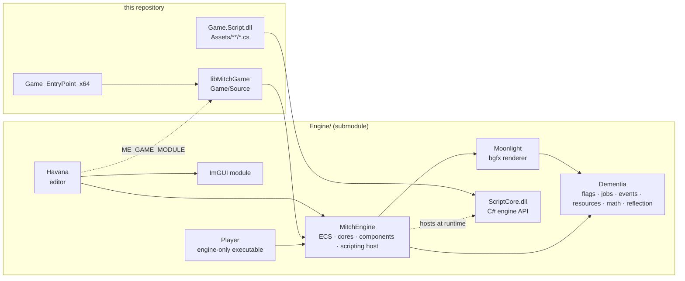
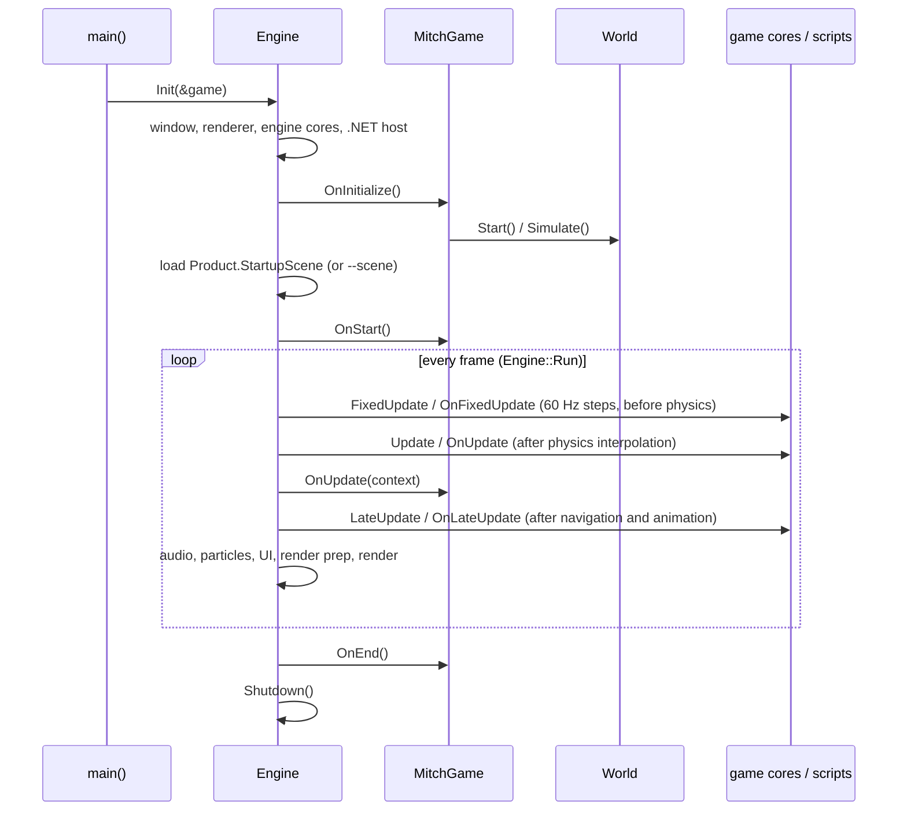
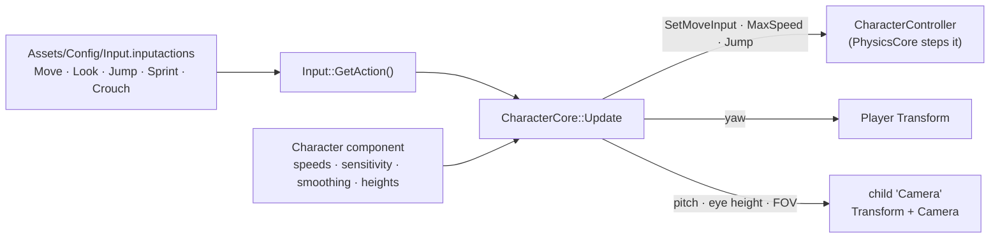
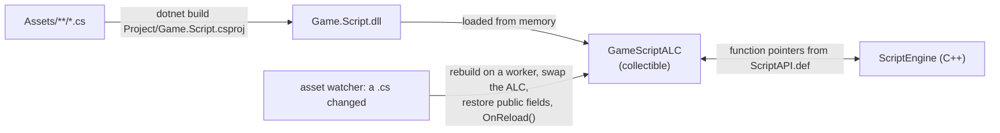
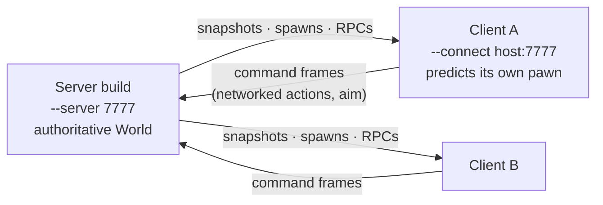

# MitchGame Architecture

How this game project is put together on top of [MitchEngine](https://github.com/wobbier/MitchEngine)
(the `Engine/` submodule). The engine's own internals are documented in `Engine/Docs/`
(start with [Architecture.md](Engine/Docs/Architecture.md), [ECS.md](Engine/Docs/ECS.md) and
[Rendering-Pipeline.md](Engine/Docs/Rendering-Pipeline.md)); this page covers what the *game* adds,
where its code runs, how content is laid out, and how the whole thing is built and verified.
Work in progress is tracked on the [issue board](ISSUES.md).

## Repository layout

```
MitchGame/
├── Engine/                 MitchEngine submodule: C++20 engine, Havana editor, ScriptCore (C#), tools, docs
├── Game/Source/            the game's C++ module (libMitchGame): the Game subclass, cores and components
├── Game_EntryPoint/        the executable: main.cpp + platform packaging (UWP manifest, icons)
├── Project/                Game.meproj (project identity), Game.Script.csproj (C# scripts), generators
├── Assets/                 content: scenes, prefabs, scripts, models, textures, terrain, UI, config
│   ├── Config/             Engine.cfg, ProjectSettings.json, Input.inputactions (the action map)
│   ├── Scenes/             playable scenes; Showcase/ (+ Reference/ PNGs); Tests/ (*.lvl + *.edscript)
│   ├── Scripts/            C# game scripts (any .cs under Assets/ compiles into Game.Script.dll)
│   └── Terrain/            .terrain manifests, .source pages, .terrainc cooked packages
├── Tools/                  scene / asset generators (Build*.py, GenerateTerrain.py) and their unit tests
├── Game.sharpmake.cs       the Sharpmake entry: project name, FMOD / .NET paths, physics flags
├── ARCHITECTURE.md         this file
└── ISSUES.md               the issue board
```

## Build targets

Sharpmake (`Project/GenerateSolution.*`, which runs `Engine/Tools/GenerateProject.sh` on Linux)
turns `Game.sharpmake.cs` + `Engine/Engine.sharpmake.cs` into the solution / makefiles. The static
libraries stack up like this:



| Target | Config | What it is |
|--------|--------|------------|
| `Havana` | `editor_debug/release/retail` | The editor, linking this game's C++ module so game cores and components exist in the World View |
| `Game_EntryPoint` | `game_linux_*` | The shipped game: engine + `libMitchGame` + the scripts |
| `Game_EntryPoint` | `server_linux_*` | The headless dedicated server (`ME_HEADLESS`: no window, bgfx Noop, no ImGui / FMOD) |
| `Player` | `game_linux_*` | The engine with no game module, for C#-only projects (`--project <folder>`) |
| `MitchEngine_Tests` | — | The engine's doctest suite (`Engine/Tests/Source`) |

The C# side is separate: `Project/Game.Script.csproj` compiles every `.cs` under `Assets/` against
`Engine/Modules/ScriptCore/ScriptCore.csproj`. On Linux and macOS the engine runs `dotnet build`
itself at startup when sources are newer than the DLL, and again on a worker thread for hot reload
in the editor; Visual Studio uses the Sharpmake-generated C# projects instead.

Feature flags (`USING( ME_EDITOR )`, `USING( ME_PLATFORM_LINUX )`, `USING( ME_HEADLESS )`, …) select
code per target; see the table in `Engine/Docs/Architecture.md`. Game code must build and run on
Win64, macOS and Linux.

## Runtime: where game code runs

The engine is a singleton `Engine` owning the window, renderer, job system and one `World`. The game
is a `Game` subclass (`MitchGame`, wired in by `ME_APPLICATION_MAIN` in `Game_EntryPoint/Source/main.cpp`).
Entities hold components (data); cores are the systems that process the entities matching their
`ComponentFilter`. Engine-owned cores (cameras, scene graph, rendering, particles, terrain, physics,
animation, navigation, audio, UI, networking, scripting) are created by `Engine::Init` and updated in a
fixed order; **game cores** are listed in a scene's `"Cores"` array and run in priority order between
them. Scripts are C# classes deriving from `ScriptCore.Script`, attached through a `ScriptComponent`.



| Stage | Game core method | Script method | Use it for |
|-------|------------------|---------------|------------|
| Fixed step | `FixedUpdate` | `OnFixedUpdate` | forces, deterministic gameplay, networked commands |
| Update | `Update` | `OnUpdate` | input, gameplay, animation parameters, nav destinations |
| Late update | `LateUpdate` | `OnLateUpdate` | follow cameras, IK targets, anything reading this frame's poses |

`MitchGame` itself (`Game/Source/MitchGame.cpp`) is thin: the boot scene comes from Project Settings
(`Product.StartupScene`, overridden by `--scene`), so `OnStart` / `OnUpdate` only keep legacy
experiments around. The interesting game code is in cores, components and scripts.

### The C++ game module

Everything in `Game/Source/` is compiled into `libMitchGame` and linked into both the game and the
editor. `ComponentRegistry.h` includes every core and component header once so their
`ME_REGISTER_CORE` / `ME_REGISTER_COMPONENT` statics are pulled into the executable (static
libraries would otherwise drop unreferenced registrations).

| Piece | Kind | Role |
|-------|------|------|
| `Components/Character` + `Cores/CharacterCore` | component + core | First-person character: Move / Look / Jump / Sprint / Crouch actions → `CharacterController`, smoothed look on the body (yaw) and its child `Camera` (pitch), eye-height and FOV transitions. Tunables are reflected fields on `Character`; runtime state lives per entity in `Character::Runtime` |
| `Components/SplitScreenPlayer` + `Cores/SplitScreenPlayerCore` | component + core | Local split screen: player 0 (WASD) and 1 (IJKL) each drive a `CharacterController`; each child camera gets half the viewport |
| `Components/SyntyUnityImporter` | component | Editor helper that rebuilds Synty Unity scenes from their exported parts |
| `Cores/TestCore`, `Cores/SceneGraphTestCore`, `Cores/PhysicsTest` | cores | Engine stress / sanity scenes (`Bench_SceneGraph.lvl`, `PhysicsTest.lvl`) |



Components serialize with reflection (`ME_REFLECT_BEGIN` fields → `Reflection::ToJson/FromJson`), so a
new tunable is one `ME_FIELD` line: it shows in the inspector, saves with the scene and is editable
from edscripts (`set Character.WalkSpeed 6`).

### Scripts (C#)

Game scripts live under `Assets/Scripts/` (`Drive/`, `LastTape/`, `LostTemple/`, `Portals/`,
`Showcase/`, `Tests/` and loose files such as `DayNightCycle.cs`). A script is a class deriving from
`Script`, placed on an entity with a `ScriptComponent` whose `ScriptFields` JSON holds its public
fields. The engine API is the `ScriptCore` namespace: `Entity` / `World` / `Query`, component
wrappers (`Transform`, `Camera`, `Light`, `CharacterController`, …), `Input`, `Physics`, `Audio`,
`UI`, `Net`, `Async` coroutines and the `EventBus`. Any reflected field of any component is reachable
by path without a wrapper (`entity.SetField("Camera", "ProceduralSky.Time", 12f)`).



Play-mode tests are static methods marked `[GameTest("Assets/Scenes/....lvl")]` (see
`Assets/Scripts/Tests/EcsTests.cs`); `game-tests <filter>` in the console runs them and logs
`GameTests: N passed, M failed`.

## Content

- **Scenes** are JSON `.lvl` files (version 2: `{"Version": 2, "Cores": [...], "Entities": [...]}`;
  each entity has a `GUID`, `Name`, `Components` and an optional `Parent` GUID). Older files use the
  version 1 shape (`"Scene"` array, no GUIDs) and are migrated on load.
- **Prefabs** are the same JSON with one root; `World.Instantiate` / `CreateFromPrefab` spawn them.
- **Showcase scenes** (`Assets/Scenes/Showcase/*.lvl`) double as screenshot references
  (`Showcase/Reference/<scene>.png`), so a visual change there is a deliberate decision.
- **Test scenes** (`Assets/Scenes/Tests/`) pair a `.lvl` with an `.edscript`: an editor automation
  script whose header names the scene (`# --scene Assets/Scenes/Tests/X.lvl`). They are the game's
  regression suite for editor and play-mode behaviour.
- **Terrain** assets are a `.terrain` manifest plus `.source/*.thp` Float32 pages (or a cooked
  `.terrainc`); `Tools/GenerateTerrain.py` writes them from Perlin noise, the editor's Terrain panel
  sculpts and paints them.
- **Config**: `Engine.cfg` (window), `ProjectSettings.json` (startup scene, input map path, hardware
  profile, build profiles), `Input.inputactions` (contexts → actions → bindings; `"Networked": true`
  actions ride in network commands), `Engine/Assets/Config/HardwareProfiles.json` (quality presets and
  caps such as `MaxTextureSize`).
- **Import settings** sit in `.meta` sidecars next to sources (textures: `Format` Auto/BC1/BC3/BC5/None,
  `MIPs`, `Type`); cooked twins (`.dds`, `.assbin`, shader binaries) are produced on demand in tools
  builds and shipped by `Havana --cook` / `--build-game`.

## Networking

The engine's `NetCore` replicates `NetIdentity` entities from a server to clients over UDP with
delta snapshots, owner prediction and lag compensation; C# marks state with `[Replicated]` /
`[Predicted]` and calls with `[ServerRpc]` / `[ClientRpc]`. This repository exercises it with
`Assets/Scenes/Tests/NetTest.lvl` + `NetProbe.cs` (the smoke test) and `Engine/Tools/RunNetLocal.py`.



## Verifying changes

| Check | Command (from the repo root, inside `Engine/Tools/DevShell.sh` on Linux) |
|-------|---------|
| Build the editor / game | `make -f MitchGame.make Havana config=editor_debug -j$(nproc)` · `make -f MitchGame.make Game_EntryPoint config=game_linux_debug -j$(nproc)` |
| Tool unit tests | `python3 -I -m unittest discover -s Tools/Tests` |
| Editor flows | `Engine/Tools/RunEditorFlows.py --editor .build/Editor_Debug/Havana --wrapper Engine/Tools/Headless.sh [--only Name]` |
| One flow by hand | `Engine/Tools/Headless.sh .build/Editor_Debug/Havana --scene Assets/Scenes/Tests/X.lvl --editor-exec Assets/Scenes/Tests/XFlows.edscript` |
| Play-mode tests | in Play: `game-tests [filter]` (flows do it with `console game-tests ...`) |
| Screenshot regression | `Engine/Tools/ScreenshotRegression.py --game .build/Game_linux_Debug/Game_EntryPoint_x64 --reference Assets/Scenes/Showcase/Reference Assets/Scenes/Showcase/*.lvl` |
| Everything | `Engine/Tools/RunChecks.sh` (`--skip-build`, `--only <filter>`) |

`Headless.sh` runs on a private Xvfb display with Mesa's lavapipe, so captures are deterministic and
nothing opens on the desktop. Logs land in `.tmp/EditorFlows/<flow>.log`; the editor logs
`[editor-exec] PASSED` when a flow succeeds.
