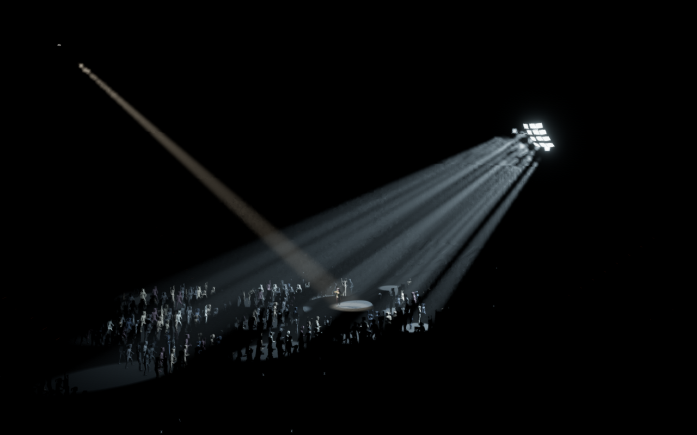

# Concert arena lighting study

Open **Assets/Scenes/Tests/ConcertTest.lvl** in Havana and press Play. The camera
looks down from the seating bowl toward a singer on a small circular stage.
The photo's red floor guides are interpreted as the arena footprint; the green
beam guides become actual light scattering in the fog.



The arena has a 34 × 64 m floor, stepped seating, roof trusses, a runway to the
rear stage, a small mixing position, and 2,255 static audience figures. Most of
the venue stays in darkness. Raised hands, scattered phones and dim aisle markers
give the crowd scale without filling the arena with light.

## Light controls

| Select in the hierarchy | What it controls |
| --- | --- |
| **Performer Spotlight** | Narrow, warm-white followspot from the upper left, aimed at the singer. The outer cone half-angle is 2.5°. |
| **Box light beam 1-1** through **Box light beam 4-3** | Twelve cool-white native Spot lights, one per luminous face. Each produces its own fog shaft and illuminates the audience where it lands. The inner/outer cone half-angles are 2.4°/3.2°, with intensity 60,000 per panel. |
| **Crowd Wash** | Transform group containing the twelve fixtures. The emitters fan outward by column and row to cover the stage surroundings and crowd. |
| **Box Light Bank** | The suspended 3-column × 4-row bank. Moving or rotating this group moves all twelve fixtures and their individual lights together. |
| **Main Camera → PostProcess** | Fog, volumetric scattering, bloom and fixed exposure. |

The performer light casts shadows. The twelve bank lights are unshadowed because
the renderer has four spot-shadow slots; each still lights surfaces and scatters
through the native volumetric fog pass. Each beam starts just ahead of its own
panel face. The fixture and its emitter share the same aim.

Set an individual beam's **Intensity** to zero to disable that panel's beam. To isolate
one panel, disable the performer light and the other eleven bank lights. Turn
**Fog** off to compare the surface illumination with
the beam silhouettes removed. **FogDensity** controls the haze; **FogSunIntensity**
also scales local-light scattering, despite its name. A low height falloff keeps
fog around the ceiling fixtures. Exposure is fixed so the dark room does not
brighten automatically when one light is disabled.

The zero-intensity **Indoor ambient - suppress sky fallback** directional is
intentional: it suppresses the renderer's automatic daylight fallback for a
solid-color camera. It contributes no illumination.

## Rebuild and verify

```bash
python3 Tools/BuildConcertTest.py

Engine/Tools/NixEnv.sh Engine/Tools/Headless.sh \
  .build/Game_linux_Debug/Game_EntryPoint_x64 \
  --scene Assets/Scenes/Tests/ConcertTest.lvl \
  --frames 32 --frame-time 0.016666667 --width 1280 --height 800 \
  --no-audio --no-debug-overlay --screenshot .tmp/ConcertTest/concert.png --exit

Engine/Tools/NixEnv.sh Engine/Tools/Headless.sh \
  .build/Editor_Debug/Havana --scene Assets/Scenes/Tests/ConcertTest.lvl \
  --editor-exec Assets/Scenes/Tests/ConcertTest.edscript
```

The builder overwrites this scene and its four normalized crowd OBJ assets.
Save editor variations under another name before rebuilding. It uses the local
Synty Prototype pack for the static crowd and the Office pack for the singer;
source assets are left intact. Crowd meshes share geometry and opaque materials
for automatic instancing. See `Tools/ConcertAssets.py` and
`Assets/Models/ConcertTest/README.md` for the asset sources.

The editor flow checks all twelve emitters, their independent controls, save/reopen,
fog settings, undo and Play/Stop. **Crowd Wash** contains no shared Light component. Comparison captures in
`.tmp/ConcertTestFlows/` show the complete
scene, the bank alone, one panel alone, the performer alone, fog disabled and the
restored scene.
